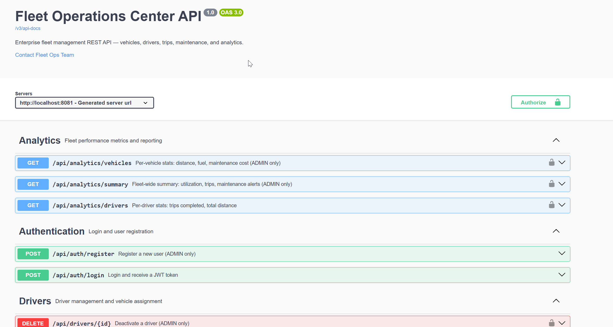
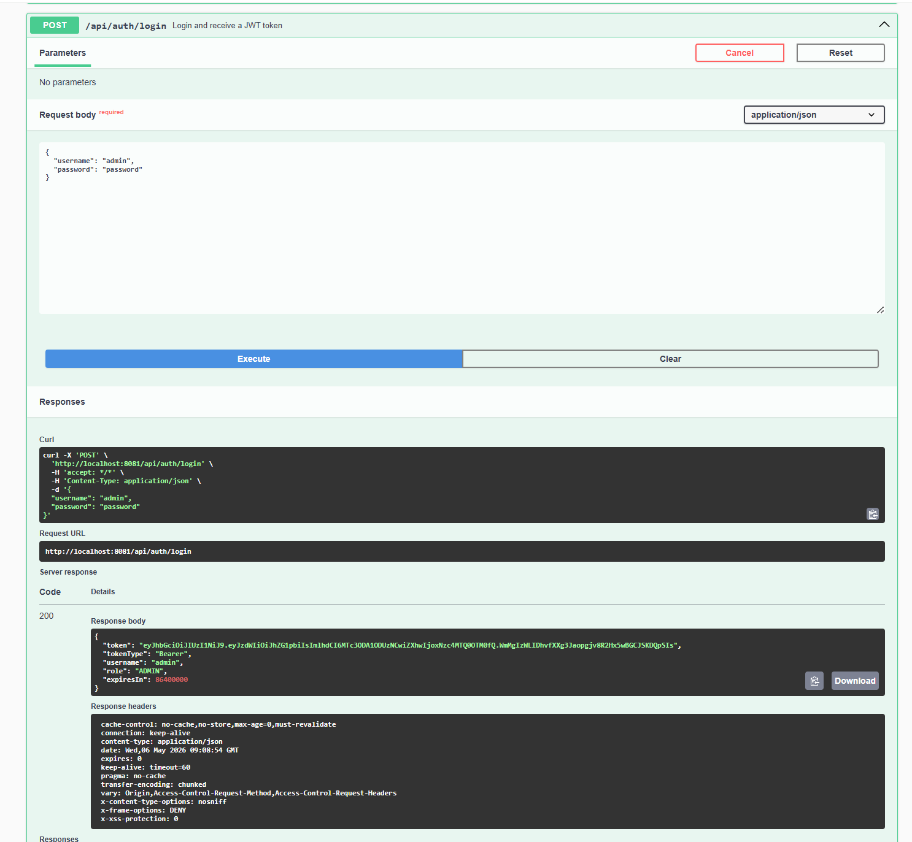
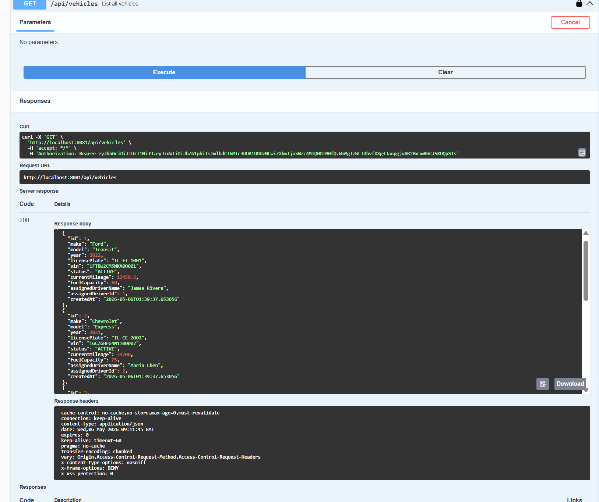

# Fleet Operations Center API

REST API for managing a vehicle fleet. Handles vehicles, drivers, trips, and maintenance scheduling. Built with Java 17 and Spring Boot 3.

Live demo: *(add Railway URL after deploy)*

---

## Tech Stack

| Layer | Technology |
|---|---|
| Language | Java 17 |
| Framework | Spring Boot 3.3.4 |
| Security | Spring Security 6 + JWT (jjwt 0.12) |
| ORM | Spring Data JPA + Hibernate |
| Database | PostgreSQL 15 |
| Migrations | Flyway |
| API Docs | SpringDoc OpenAPI / Swagger UI |
| Validation | Bean Validation (jakarta.validation) |
| Build | Maven 3.9 |
| Tests | JUnit 5 + Mockito |

---

## What it does

- **Auth** — login returns a JWT; every other endpoint requires it
- **Role-based access** — three roles (`ADMIN`, `DISPATCHER`, `DRIVER`) with different permissions per endpoint
- **Vehicles** — register, update, track status (ACTIVE / IDLE / MAINTENANCE / RETIRED)
- **Drivers** — manage driver records, license expiry, and vehicle assignments
- **Trips** — start, close, or cancel a trip; odometer and fuel usage tracked automatically
- **Maintenance** — schedule and complete service records; a background job runs at 06:00 daily and flags anything overdue
- **Analytics** — fleet utilization, per-vehicle cost and distance, and per-driver stats
- **Consistent error responses** — every error comes back as JSON with a status, message, and timestamp
- **Swagger UI** — interactive docs with Bearer token support at `/swagger-ui.html`

---

## Screenshots

**API overview**


**Login returning a JWT**


**Fetching the vehicle list (authenticated)**


---

## Prerequisites

- Java 17+ ([Temurin 17 LTS](https://adoptium.net))
- Maven 3.9+ ([download](https://maven.apache.org/download.cgi))
- PostgreSQL 15+ ([download](https://www.postgresql.org/download/))

---

## Project Structure

```
fleet-ops/
├── backend/          # Java 17 + Spring Boot 3 REST API (Maven)
│   ├── src/          # Controllers, Services, Repositories, Entities, Flyway migrations
│   ├── pom.xml       # Maven dependencies & build configuration
│   └── README.md     # Detailed backend architecture documentation
├── frontend/         # React 19 + TypeScript + Vite + Tailwind CSS dashboard
│   ├── src/          # React components, pages, hooks, API client
│   └── package.json  # NPM dependencies & scripts
└── docs/             # Documentation assets & screenshots
```

---

## Local Setup

### 1. Database (MySQL / MySQL Workbench)

Backend is configured to connect to your local **MySQL 8.0** on port `3306`:
- **Host:** `localhost`
- **Port:** `3306`
- **Database:** `fleet_ops` (Flyway & MySQL URL automatically create this schema if it does not exist)
- **User:** `root`
- **Password:** `root` (configurable via `DB_PASSWORD`)

Aap MySQL Workbench open karke `fleet_ops` schema ke andar sabhi tables (`users`, `vehicles`, `drivers`, `trips`, `maintenance_records`, `flyway_schema_history`) dekh sakte hain!

Optional: Agar aapko credentials change karne hon:
```yaml
# backend/src/main/resources/application.yml
spring:
  datasource:
    url: jdbc:mysql://localhost:3306/fleet_ops?createDatabaseIfNotExist=true&useSSL=false&allowPublicKeyRetrieval=true&serverTimezone=UTC
    username: root
    password: your_mysql_password
```

### 2. Run Backend (Spring Boot)

```bash
cd backend
mvn spring-boot:run
```

- API Base URL: `http://localhost:8080`
- Swagger UI: `http://localhost:8080/swagger-ui.html`

Flyway runs on startup and applies both migrations automatically:
- `V1__init_schema.sql` — tables, foreign keys, and indexes
- `V2__seed_data.sql` — sample users, vehicles, drivers, and trips

### 4. Run Frontend (React + Vite)

Open a new terminal:

```bash
cd frontend
npm install
npm run dev
```

The frontend will run at `http://localhost:3000` with automated proxying to the Spring Boot backend (`http://localhost:8080`).

---

## Seed Credentials

All seed users have the password `password`.

| Username | Role | Access |
|---|---|---|
| `admin` | ADMIN | Everything |
| `dispatcher` | DISPATCHER | Trips, driver assignments, fleet view |
| `driver1` | DRIVER | Their own trips |
| `driver2` | DRIVER | Their own trips |

### Getting a token

```bash
curl -X POST http://localhost:8080/api/auth/login \
  -H "Content-Type: application/json" \
  -d '{"username": "admin", "password": "password"}'
```

Pass the returned token as `Authorization: Bearer <token>` on all subsequent requests.

---

## API Reference

### Authentication
| Method | Endpoint | Access | Description |
|---|---|---|---|
| POST | `/api/auth/login` | Public | Login, returns JWT |
| POST | `/api/auth/register` | ADMIN | Create a new user |

### Vehicles
| Method | Endpoint | Access | Description |
|---|---|---|---|
| GET | `/api/vehicles` | ADMIN, DISPATCHER | List all vehicles |
| GET | `/api/vehicles/{id}` | All roles | Get a vehicle |
| POST | `/api/vehicles` | ADMIN | Register a vehicle |
| PUT | `/api/vehicles/{id}` | ADMIN | Update a vehicle |
| PATCH | `/api/vehicles/{id}/status` | ADMIN, DISPATCHER | Update status |
| DELETE | `/api/vehicles/{id}` | ADMIN | Delete a vehicle |

### Drivers
| Method | Endpoint | Access | Description |
|---|---|---|---|
| GET | `/api/drivers` | ADMIN, DISPATCHER | List all drivers |
| GET | `/api/drivers/active` | ADMIN, DISPATCHER | List active drivers |
| GET | `/api/drivers/{id}` | All roles | Get a driver |
| POST | `/api/drivers` | ADMIN | Create a driver |
| PUT | `/api/drivers/{id}` | ADMIN | Update a driver |
| PATCH | `/api/drivers/{id}/assign/{vehicleId}` | ADMIN, DISPATCHER | Assign a vehicle |
| PATCH | `/api/drivers/{id}/unassign` | ADMIN, DISPATCHER | Remove assignment |
| DELETE | `/api/drivers/{id}` | ADMIN | Deactivate a driver |

### Trips
| Method | Endpoint | Access | Description |
|---|---|---|---|
| GET | `/api/trips` | ADMIN, DISPATCHER | List all trips |
| GET | `/api/trips/{id}` | All roles | Get a trip |
| GET | `/api/trips/vehicle/{vehicleId}` | ADMIN, DISPATCHER | Trips by vehicle |
| GET | `/api/trips/driver/{driverId}` | All roles | Trips by driver |
| POST | `/api/trips` | All roles | Start a trip |
| PATCH | `/api/trips/{id}/close` | All roles | Close a trip |
| PATCH | `/api/trips/{id}/cancel` | ADMIN, DISPATCHER | Cancel a trip |

### Maintenance
| Method | Endpoint | Access | Description |
|---|---|---|---|
| GET | `/api/maintenance` | ADMIN, DISPATCHER | List all records |
| GET | `/api/maintenance/{id}` | ADMIN, DISPATCHER | Get a record |
| GET | `/api/maintenance/vehicle/{vehicleId}` | ADMIN, DISPATCHER | Records by vehicle |
| GET | `/api/maintenance/overdue` | ADMIN, DISPATCHER | Overdue records |
| GET | `/api/maintenance/upcoming?days=7` | ADMIN, DISPATCHER | Upcoming records |
| POST | `/api/maintenance` | ADMIN, DISPATCHER | Schedule maintenance |
| PATCH | `/api/maintenance/{id}/complete` | ADMIN, DISPATCHER | Mark complete |
| DELETE | `/api/maintenance/{id}` | ADMIN | Delete a pending record |

### Analytics
| Method | Endpoint | Access | Description |
|---|---|---|---|
| GET | `/api/analytics/summary` | ADMIN | Fleet-wide summary |
| GET | `/api/analytics/vehicles` | ADMIN | Per-vehicle stats |
| GET | `/api/analytics/drivers` | ADMIN, DISPATCHER | Per-driver stats |

---

## Running Tests

```bash
mvn test
```

Unit tests use Mockito. No database needed.

---


```
DB_URL=jdbc:postgresql://<host>:5432/<db>
DB_USERNAME=<user>
DB_PASSWORD=<password>
JWT_SECRET=<random base64 string>
PORT=8080
```

5. Railway detects Maven and builds with `mvn package`
6. Swagger UI: `https://your-app.up.railway.app/swagger-ui.html`

---

## Project Structure

```
src/
├── main/java/com/fleetops/
│   ├── config/          # Security, OpenAPI config
│   ├── controller/      # REST controllers
│   ├── dto/
│   │   ├── request/
│   │   └── response/
│   ├── exception/       # Custom exceptions + global handler
│   ├── model/           # JPA entities + enums
│   │   └── enums/
│   ├── repository/      # Spring Data JPA repositories
│   ├── security/        # JWT util, filter, UserDetailsService
│   └── service/         # Business logic
└── main/resources/
    ├── application.yml
    └── db/migration/
        ├── V1__init_schema.sql
        └── V2__seed_data.sql
```
